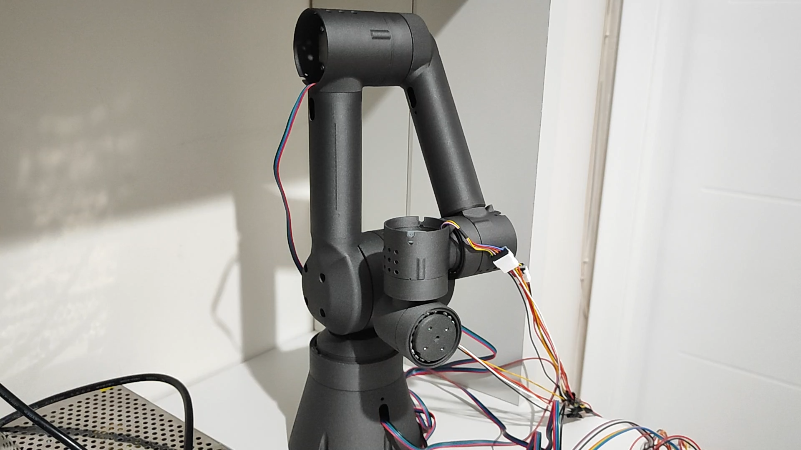
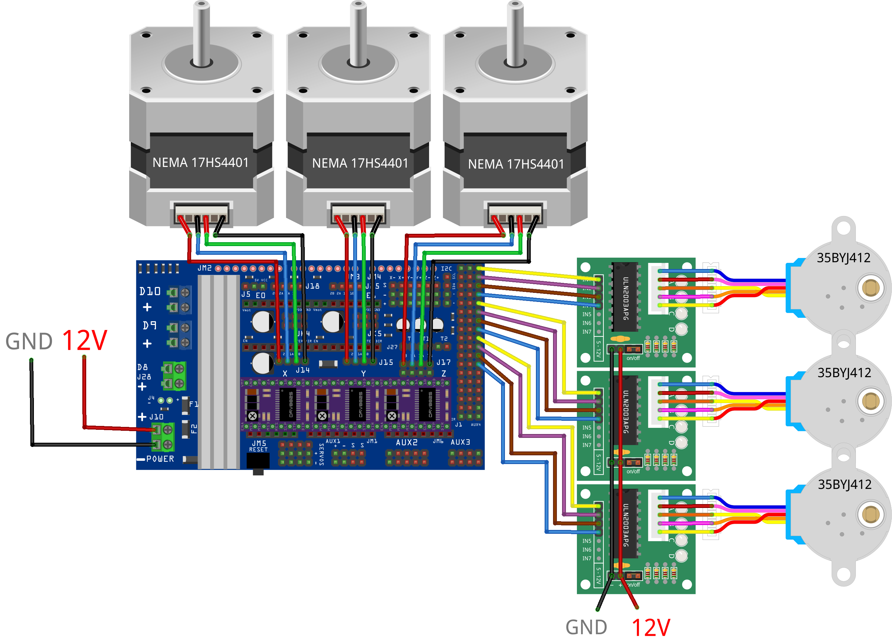

# 3D Printed 6-Axis Robot Arm

This repository contains the software, CAD modifications, and documentation for a 3D-printed 6-axis robot arm based on LoboCNC's original design.



## Hardware Diagram


## Project Links

The original 3D models for this build can be found here:

- **Robot Arm Body:** [WE-R2.4 Six-Axis Robot Arm (Printables)](https://www.printables.com/model/132260-we-r24-six-axis-robot-arm)
- **Actuators:** [Robot Actuators (Printables)](https://www.printables.com/model/132262-robot-actuators)


My YouTube channel, where you can watch the build process and future projects involving this robot arm:
- https://www.youtube.com/@ozguremreucar
## Components Used

| Item | Quantity |
| :--- | :--- |
| Nema 17HS4401 Stepper Motor| 3 |
| 35BYJ412 Stepper Motor| 3 |
| DRV8825 | 3 |
| ULN2003A | 3 |
| Arduino Mega | 1 |
| Reprap Ramps 1.6 Plus | 1 |
| 12V 20A Power Supply | 1 |
| 6mm Steel Ball | - |

## Project Structure

- `Assets/` - Contains images, diagrams, and other media related to the project.
  - `images/` - Photos of the build process and the completed robot arm.
  - `docs/` - Datasheets and other documentation.
- `CAD/` - Contains modified 3D models and CAD files.
- `Software/` - Contains the control code and related software for the robot arm.

## Getting Started (ROS 2 via Docker)

Follow these steps to set up the software environment and run the ROS 2 launch file. We use Docker to ensure a consistent environment.

### 1. Install Docker (If not installed)

Depending on your operating system, use the appropriate package manager to install Docker.

**For Debian/Ubuntu-based systems:**

```bash
sudo apt update && sudo apt install -y docker.io docker-compose-v2
```

**For Arch-based systems (like CachyOS, Manjaro, EndeavourOS):**
```bash
sudo pacman -Sy docker docker-compose
```

**(Optional but recommended) Allow your user to run Docker commands without sudo, and start the service:**

Add your user to the docker group and start the service:
```bash
sudo usermod -aG docker $USER && sudo systemctl enable --now docker
```
Apply the new group membership (in your current terminal):
```bash
newgrp docker
```
*(Note: `enable --now` configures Docker to start automatically on every boot. If you prefer to start it manually only when you need it, use `sudo systemctl start docker` instead.)*

### 2. Build and Run the Docker Container

Navigate to the ROS directory and build the Docker image:
```bash
cd Software/ROS && docker build -t ros2_dev:latest .
```

Start the container and enter the interactive shell using `docker compose run`. The `--rm` flag ensures the container is automatically removed when you exit, keeping your system clean. Choose the command depending on your hardware:

*(Note: On some systems like CachyOS or those using Wayland, GUI applications may work out-of-the-box. If you encounter display issues with applications like RViz not opening, you may need to allow Docker access to your X server by running `xhost +local:root` on your host machine before starting the container.)*

**For standard CPU:**
```bash
docker compose --profile cpu run --rm ros2_dev
```

**OR, if you have an NVIDIA GPU** (requires nvidia-container-toolkit):
```bash
docker compose --profile nvidia run --rm ros2_dev_nvidia
```

**OR, for AMD GPUs:**
```bash
docker compose --profile amd run --rm ros2_dev_amd
```

### 3. Launch the Robot Arm

Once inside the container's shell, build the workspace and launch the robot:

```bash
colcon build && source install/setup.bash && ros2 launch robot_moveit_config robot_arm.launch.py
```
